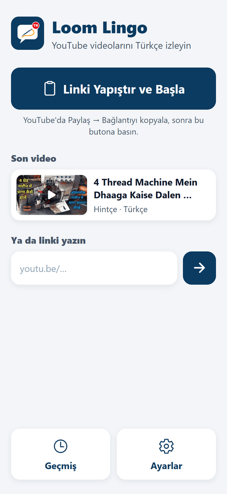
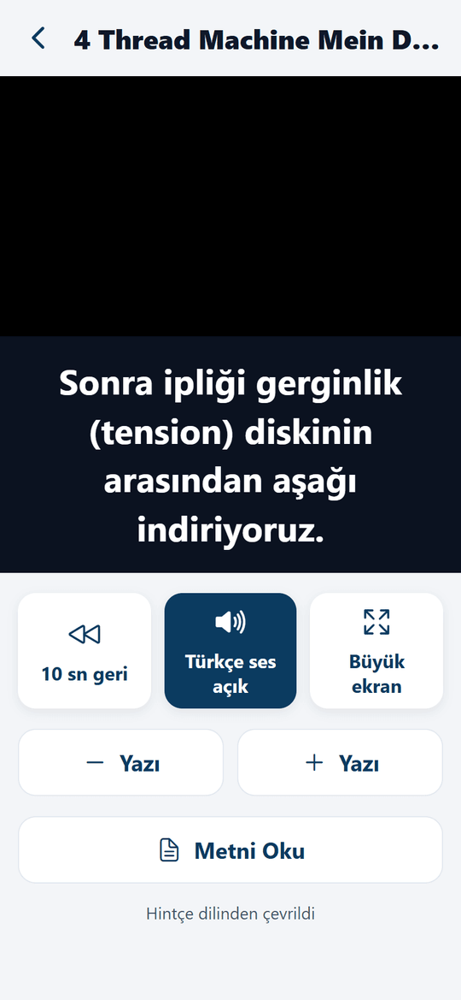
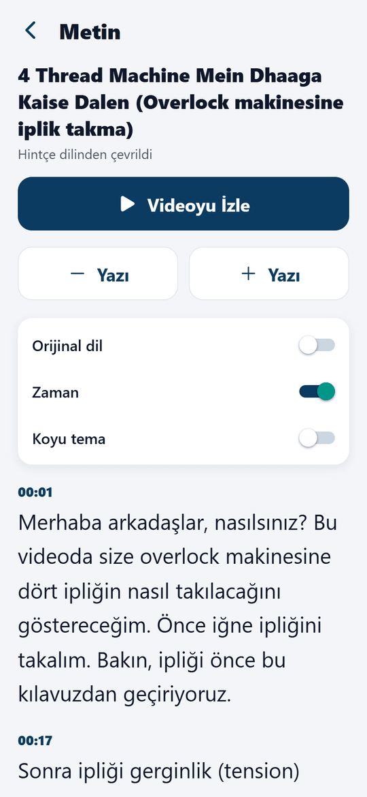
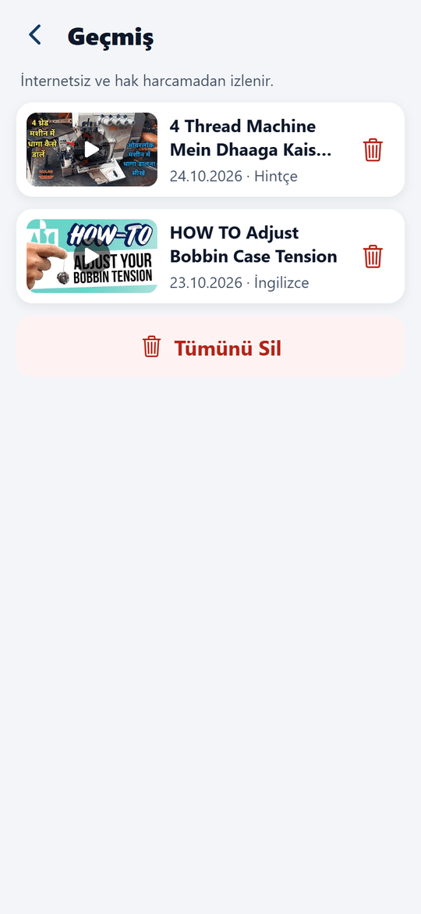
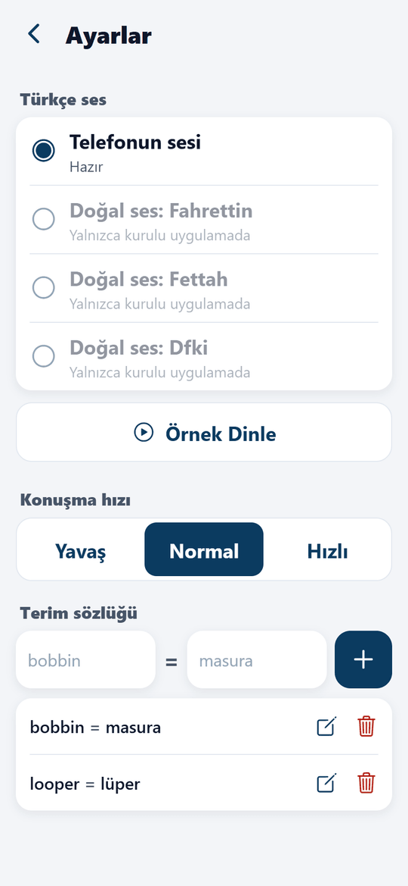

# Loom Lingo

A personal-use Android app for watching YouTube videos in Turkish. You paste a link, or share a video from the YouTube app. The app translates the speech, then plays the video with **large Turkish subtitles** and a **Turkish voice-over** that stays in sync with the picture. It was built for one older user who watches textile-machine training videos (sewing, overlock, embroidery, weaving, knitting) in English, Hindi, Bengali and other languages. The interface is in Turkish, uses large high-contrast text, and has as few screens as possible.

- **Free to run.** Gemini's free API tier, no backend, no paid services.
- **Stack:** Expo SDK 57, React Native 0.86 and TypeScript. Android only. Installed as an APK built with EAS Build, not published on Google Play.

## Screenshots

| Home | Watching (Turkish subtitle + voice) | Reading |
| :---: | :---: | :---: |
|  |  |  |

| History | Settings |
| :---: | :---: |
|  |  |

How these were made:
- They were rendered from the app's web build in headless Chrome at phone size (412 × 892), using sample data from a real Hindi overlock video.
- On the watch screen, the subtitle line was placed by hand, because the subtitle sync uses WebView features that only work on the phone.
- In Settings, the natural voices look disabled because they need the APK; on the phone they can be downloaded.

## How it works

```
link ─► local history (cache) ─► YouTube captions ─► Gemini text translation ─┐
                                     │ none / unusable                        ├─► timed Turkish cues
                                     └────────────► Gemini video input (URL) ─┘          │
                                                                                         ▼
                     Watch screen: YouTube player + large subtitle box + Turkish voice (elastic sync)
```

1. **Cache first.** A video that was already translated opens from the phone's history. No internet or API quota is used.
2. **Captions path (fast, cheap).** [services/transcript.ts](services/transcript.ts) reads the video's caption track list. It prefers a human Turkish track, then a human track in the spoken language, then any human track, then the automatic track. Caption lines are grouped into sentence-sized **cues** with start and end times, then translated by Gemini in batches ([services/translate.ts](services/translate.ts)). Turkish tracks are shown as they are, without translation. Tracks with too little text (fewer than 60 characters per minute) are treated as unusable. A typical case is an English auto-caption on a Bengali video.
3. **Gemini video path (fallback).** [services/geminiVideo.ts](services/geminiVideo.ts) passes the public YouTube URL straight to Gemini. Gemini listens to the audio, looks at the frames, and returns timed cues with the original speech and its Turkish translation. Timestamps are requested as `MM:SS`: asked for plain seconds, Gemini sometimes wrote 5:26 as 526. Cues longer than 9 seconds are split at word boundaries for the subtitle box. Videos longer than 20 minutes are processed in 10-minute sections using `video_metadata` offsets, with progress shown as "Bölüm 2/3 çevriliyor…".
4. **Watch screen** ([screens/WatchScreen.tsx](screens/WatchScreen.tsx)). YouTube's official embed page is opened directly in a WebView ([components/YoutubeVideo.tsx](components/YoutubeVideo.tsx)), sent with a `Referer` header that identifies the app. Because the page is not nested inside another page's iframe, the app can reach its `<video>` element: it reads the time, pauses and resumes for the voice sync, seeks, and detects ads so subtitles wait for the real video. Below it, a large dark box shows the current Turkish line; the text size follows A−/A+. The original sound is muted while the Turkish voice is on and re-muted at once if YouTube turns it back on; it returns when the voice is switched off. This was tested with Chrome and an Android WebView user agent against a real YouTube page. Playback is started by tapping the video itself, because YouTube does not reliably start from a call that did not come from a tap.
   - **Büyük Ekran** turns the phone sideways (`expo-screen-orientation`). The video then fills the screen and the subtitle is drawn over its lower part. The player stays mounted, so the video does not restart. The Android back button returns to the normal view first; elsewhere it goes back a screen instead of closing the app.
5. **Turkish voice and elastic sync** ([services/dubController.ts](services/dubController.ts)). Each cue is spoken when it starts. Because Turkish is often longer than the source:
   - the voice may use the time until the next cue begins;
   - it uses a shorter "spoken" version from Gemini when the full line would not fit;
   - it speeds up to at most 1.25×;
   - if it still runs over, **the video pauses briefly** until the sentence ends.

   Voice and picture never drift apart. In tests with real videos, the pauses added 1–5 % to the running time.
6. **Errors.** Every failure is shown in plain Turkish with a **Tekrar Dene** (retry) button. Failures covered: no internet, invalid link, video missing or not accessible, invalid or missing key, daily limit reached, and service busy.

[services/pipeline.ts](services/pipeline.ts) wires these steps together. [services/gemini.ts](services/gemini.ts) holds the shared Gemini client and the textile-domain system instruction, which also carries the user's glossary.

### Turkish voices

| Voice | How | Size | Notes |
| --- | --- | --- | --- |
| Phone voice (default) | Android text-to-speech via `expo-speech` | – | Ready immediately, offline; somewhat robotic. Works in Expo Go. |
| Natural voices: Fahrettin, Fettah, Dfki | [Piper](https://github.com/rhasspy/piper) models running on the phone via [sherpa-onnx](https://github.com/k2-fsa/sherpa-onnx) (`react-native-sherpa-onnx`) | 21 MB each, downloaded once from Settings | Offline, more natural. APK only. |

The natural voices use the **int8** builds from the sherpa-onnx `tts-models` release, because the fp16 builds failed to load in sherpa-onnx 1.12. Measured on a PC, they speak 16–18 characters per second and generate at 0.3–0.5× real time. Sentences are generated a few cues ahead and cached as WAV files per video. If a clip is not ready in time, the video waits ("Türkçe ses hazırlanıyor…").

### Why these methods (checked October 2026)

| Question | Finding | Decision |
| --- | --- | --- |
| Official YouTube Data API for captions? | `captions.download` only works for the video owner (OAuth). | Not usable. |
| Old `youtube.com/api/timedtext?type=list` | Returns an empty body. | Removed. |
| Caption URLs from the watch web page | Return empty bodies without a proof-of-origin token. | Not usable. |
| Innertube `youtubei/v1/player` with the Android client | Returns title, length and caption tracks; the track URLs download normally. | **Used**, isolated in one file. |
| YouTube's own auto-translation (`tlang=tr`) | Works, but quality on textile terms is weak and it ignores the glossary. | Not used; Gemini translates instead. |
| Gemini YouTube URL input | Documented ([video understanding](https://ai.google.dev/gemini-api/docs/video-understanding)); public videos only; clipping offsets supported. | **Used** as the fallback. |
| Downloading the video and burning in subtitles or audio | Against YouTube's terms, needs large files and a PC-class tool chain. | Not used; the official player is embedded instead. |
| Voice cloning or desktop dubbing tools (XTTS, VideoLingo, pyVideoTrans) | Need a GPU or PC. | Not used. |
| Gemini TTS | Low free quota; one request per sentence would use it up quickly. | Not used. |

Tested end to end with real videos:
- Hindi auto-captions, translated via the captions path in about 16 seconds with one request.
- A 22-minute Bengali video whose only caption track was a wrong-language auto-caption. It went through the video path in 3 sections in about 70 seconds.

## Gemini models and free-tier limits

The app uses `gemini-3.5-flash-lite`, then `gemini-3.5-flash`, then `gemini-3.8-flash`. When one model's free **daily** quota runs out, the next model is tried automatically, because each model has its own quota. Per-minute rate limits are waited out, using the delay Google suggests (up to 60 s). Temporary server errors are retried.

Free-tier facts from Google's documentation (subject to change):
- YouTube URL input is limited to **8 hours of YouTube video per day** in total.
- **Private and unlisted videos are not supported** by the video path. Unlisted videos still work through the captions path.
- Per-model request limits are shown in [Google AI Studio](https://aistudio.google.com/) under *Usage / Rate limits*.

### Daily limit warnings

Google does not tell a free API key how much quota is left; limits are only shown in AI Studio. An earlier version showed an estimated usage bar, but its numbers were guesses, so it was removed. The app now shows only what Google actually reports ([services/quota.ts](services/quota.ts), [utils/quota.ts](utils/quota.ts)):
- When a model answers "daily quota used up", it is remembered and skipped until the reset.
- Google resets free quotas at midnight Pacific time, which is 10:00 or 11:00 in Turkey; US summer time is handled.
- When every model is used up, the home screen says so and gives the reset time ("yarın saat 10:00"). History still works.
- Before translating a video over an hour long, the app asks for confirmation.

A typical day of 5–10 short videos (about 30 minutes) needs about 5–15 requests. Re-watching a video uses none.

## Project structure

```
App.tsx                  screen switching + share-intent handling
screens/                 HomeScreen, WatchScreen, ResultScreen (reading), HistoryScreen, SettingsScreen
components/              YoutubeVideo (player), Button/Tile, Header, VideoCard, ProgressCard, ErrorCard, theme
hooks/useShareIntent.ts  receives links shared from the YouTube app (APK only)
services/
  pipeline.ts            cache → captions → Gemini video
  transcript.ts          everything that talks to YouTube (replaceable)
  gemini.ts              Gemini client, model fallback, retries, system prompt
  translate.ts           caption translation in batches
  geminiVideo.ts         Gemini YouTube-URL path, long-video sections
  dubController.ts       keeps the Turkish voice in step with the video (elastic sync)
  voices.ts              phone voice + Piper voices (download, generate, play)
  quota.ts               remembers models whose daily quota is used up
  cache.ts               history / cache (AsyncStorage)
  settings.ts            settings, API key from .env
utils/                   link parsing, cues and speech planning, quota day maths, text chunking, language names
__tests__/               unit tests
```

## Setup from zero (Windows)

1. Install **Node.js 22 LTS** from [nodejs.org](https://nodejs.org/) and **Git**.
2. Get the code and install dependencies:

   ```powershell
   git clone <your-repository-url>
   cd LoomLingo
   npm install
   ```

3. Create the key file (see the next section):

   ```powershell
   copy .env.example .env
   ```

## Get a free Gemini API key

1. Open [Google AI Studio → API keys](https://aistudio.google.com/app/apikey) and sign in with a Google account.
2. Click **Create API key** and pick or create a project. No billing account is needed for the free tier.
3. Open `.env` and paste the key:

   ```
   EXPO_PUBLIC_GEMINI_API_KEY=your-key-here
   ```

4. Restart `npx expo start` after changing `.env`. Build a new APK for the change to reach the phone.

How the key is handled:
- `.env` is listed in `.gitignore`, so it is never committed.
- `.env` is **not** listed in [.easignore](.easignore), so EAS Build receives it and bundles the key into the APK. EAS uses `.easignore` instead of `.gitignore` when it uploads the project.
- `EXPO_PUBLIC_` values can be extracted from an APK. Keep the APK private.
- There is no key field in the app. To change the key, edit `.env` and build a new APK.

## Try it on the phone with Expo Go (quick UI test)

1. Install **Expo Go** from Google Play and update it to the latest version (it must support SDK 57).
2. Connect the phone and the computer to the same Wi-Fi network.
3. Start the development server:

   ```powershell
   npx expo start --clear
   ```

4. Scan the QR code with Expo Go.

These work in Expo Go:
- pasting a link, translating, and watching with subtitles and the phone voice.

These need the APK:
- **receiving a share from the YouTube app**;
- the **natural (Piper) voices**.

## Build the APK with EAS (free account)

1. Create a free account at [expo.dev](https://expo.dev).
2. Sign in and start the build:

   ```powershell
   npx eas-cli@latest login
   npx eas-cli@latest build --platform android --profile preview
   ```

   - On the first build, answer **Y** to *Generate a new Android Keystore?*. Expo stores the signing key and reuses it for updates.
   - The free tier queues builds; a build usually takes 10–20 minutes.

   - **APK size.** `expo-build-properties` in `app.json` builds only for `arm64-v8a`, which every Android phone sold since about 2017 uses. It also stores native libraries compressed (`useLegacyPackaging`).
     - Without these settings the APK was 221 MB: four CPU architectures, each with its own copy of onnxruntime for the natural voices.
     - If a very old 32-bit phone reports the app as incompatible, add `"armeabi-v7a"` to `buildArchs`.

3. When the build finishes, EAS prints a link. The same build also appears on expo.dev under *Projects → loom-lingo → Builds*.

### Install the APK on the phone

1. Open the build link **on the phone** and tap **Install** or **Download**.
2. Open the downloaded `.apk`.
3. If Android warns about unknown apps, tap **Ayarlar**, turn on **Bu kaynaktan izin ver** for the browser or the Files app, then go back and tap **Yükle**.
4. If Play Protect asks, choose **Yine de yükle**. The app is unknown to Google because it is not on Google Play.
5. Open **Loom Lingo**. To translate a video, either:
   - in YouTube, tap **Paylaş → Loom Lingo** on a video, and translation starts automatically; or
   - copy the link in YouTube, then tap **Linki Yapıştır ve Başla** on the home screen.

   When the translation is ready, the watch screen opens. Tap **Oynat**.
6. Optional: in **Ayarlar → Türkçe Ses**, pick a natural voice (21 MB download, Wi-Fi recommended) and tap **Örnek Dinle** to hear it.
7. If the phone voice is silent, the phone has no Turkish text-to-speech voice. On Android, open *Settings → System → Language → Text-to-speech output*, then install Turkish for Google's speech engine. Alternatively, pick a natural voice.

To update the app later, build again and install the new APK over the old one. History and settings are kept.

## Tests and checks

```powershell
npm run typecheck     # TypeScript, strict
npm test              # Jest unit tests
npx expo-doctor       # Expo dependency/config checks
```

The unit tests cover:
- YouTube link parsing (watch, youtu.be, shorts, live, m.youtube, links inside shared text)
- sentence-aware chunking and paragraph batching
- caption-line grouping and caption track choice
- long-video section planning
- cue building, `MM:SS` parsing, long-cue splitting, and speech planning (short version and speed-up)
- the elastic-sync controller:
  - speaking on cue;
  - pausing the video while a sentence finishes;
  - waiting for a clip that is still generating;
  - seeking, voice off, and the user pressing pause
- quota-day maths, including US summer time
- Gemini:
  - model fallback;
  - remembering used-up models;
  - rate-limit waiting;
  - invalid-key and offline errors

## Maintenance notes

**Captions stopped working** (every video goes through the slower video path):
1. Edit only [services/transcript.ts](services/transcript.ts).
2. First try a newer `clientVersion` in `CLIENT`, using the current YouTube Android app version.
3. If the response format changed, update the field names in `getVideoInfo` / `getCaptionTranscript`.

The app keeps working in the meantime through the Gemini video path.

**Gemini model retired or renamed:**
- Update `MODELS` in [services/gemini.ts](services/gemini.ts).
- To list the models your key can use:

  ```powershell
  curl "https://generativelanguage.googleapis.com/v1beta/models" -H "x-goog-api-key: YOUR_KEY"
  ```

**Video does not play inside the app:**
- Some channels disable embedding. The app then offers *YouTube'da Aç* and *Metni Oku*.
- If no video plays at all, YouTube may have changed its embed rules or page structure. All of it is in [components/YoutubeVideo.tsx](components/YoutubeVideo.tsx): the embed URL, the `Referer` header, and the selectors `video`, `.html5-video-player.ad-showing` and `.ytp-error`.

**Natural voice problems:**
- The model URLs are in `PIPER_VOICES` / `archiveUrl` in [services/voices.ts](services/voices.ts).
- `react-native-sherpa-onnx` is pinned to a fixed version. Its bundled sherpa-onnx (1.12.x) still reads Piper's `espeak-ng-data`.
- sherpa-onnx 2.0 dropped that and needs an external phonemizer. Do not upgrade without testing.
- `@dr.pogodin/react-native-fs` (a peer of sherpa-onnx) is pinned to 2.40.4. Version 2.41.0 uses `ArrayBuffer` in its native spec, which React Native 0.86's codegen rejects, and the Gradle build fails.
- Before spending an EAS build on a native dependency change, check every package's spec locally:

  ```powershell
  node node_modules/@react-native/codegen/lib/cli/combine/combine-js-to-schema-cli.js out.json --platform android node_modules/<package>/src
  ```

**Videos pause too often:**
- Choose **Hızlı** (fast) speech in Settings, or a natural voice; they speak faster than the phone voice.
- `MAX_SPEECH_RATE` in [utils/cues.ts](utils/cues.ts) caps the speed-up.

**App icon:** `assets/icon.png` and `assets/adaptive-icon.png` (artwork inside the adaptive-icon safe zone on a `#0B3B60` background). They show a speech bubble with a threaded sewing needle and a "TR" badge.

**Glossary:** Settings → *Terim Sözlüğü*. Every entry is added to the system instruction of every Gemini request.

**EAS build fails:**
- Run `npx expo-doctor` and `npx expo install --check` first.
- Make sure `package-lock.json` is saved before building: EAS installs exactly what the lock file says.
- An earlier failure (`Cannot invoke method getAbsolutePath() on null object` in `app/build.gradle`) came from a stale lock file that mixed React Native 0.81 with SDK 57.
